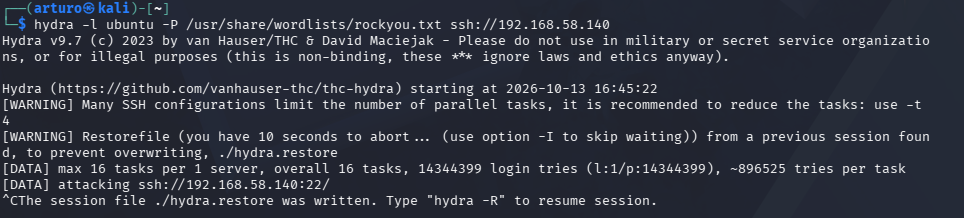
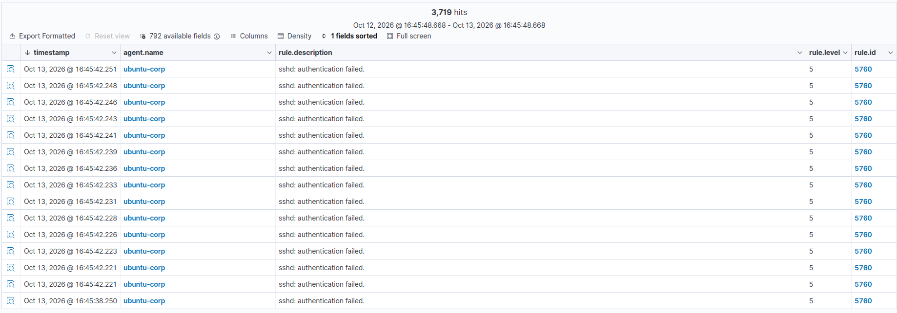

# UC01 — Fuerza bruta SSH contra servidor Linux

| Campo | Valor |
|---|---|
| Origen | Kali Linux (192.168.58.134) |
| Objetivo | Ubuntu corporativo (192.168.58.140) |
| Técnica MITRE ATT&CK | [T1110 — Brute Force](https://attack.mitre.org/techniques/T1110/) |
| Fuente de detección | Agente Wazuh en el host, log `sshd` |
| Regla Wazuh | `5760` — *sshd: authentication failed* |

## Ataque

Desde el Kali, ataque de diccionario contra el servicio SSH con
Hydra:

```bash
hydra -l ubuntu -P /usr/share/wordlists/rockyou.txt ssh://192.168.58.140
```



## Detección

El agente Wazuh instalado en `ubuntu-corp` procesa `/var/log/auth.log`
y genera una alerta por cada intento fallido. En pocos segundos se
acumularon miles de eventos:



En la prueba real se generaron **3.719 eventos** de la regla `5760`
en menos de un minuto, todos sobre el agente `ubuntu-corp`.

## Por qué se detecta

Wazuh incluye de serie el decoder y las reglas para `sshd`. Cada
línea `Failed password for ...` en `auth.log` se traduce en un evento
de nivel 5. Un volumen tan alto de eventos en tan poco tiempo (varios
por segundo desde el mismo origen) es la firma típica de un ataque de
fuerza bruta automatizado, frente a un usuario real que se equivoca
de contraseña una o dos veces.

## Mejora propuesta

- Activar **Active Response** de Wazuh para bloquear la IP de origen
  tras N intentos fallidos en una ventana de tiempo (`active-response`
  con el script `firewall-drop`).
- Añadir una regla de correlación que agrupe estos eventos y escale
  el nivel de alerta cuando se supere un umbral (por ejemplo, 10
  fallos en 30 segundos desde la misma IP).
