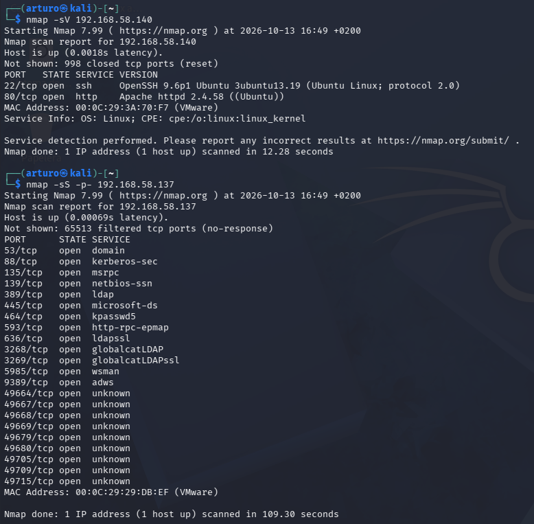
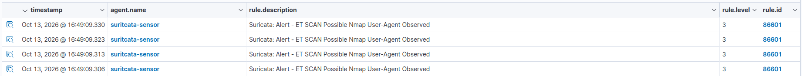

# UC02 — Escaneo de puertos con Nmap

| Campo | Valor |
|---|---|
| Origen | Kali Linux (192.168.58.134) |
| Objetivos | Ubuntu corporativo (.140), Windows Server (.137) |
| Técnica MITRE ATT&CK | [T1046 — Network Service Discovery](https://attack.mitre.org/techniques/T1046/) |
| Fuente de detección | Sensor Suricata (eve.json / fast.log) |
| Regla Wazuh | `86601` — *Suricata: ET SCAN Possible Nmap User-Agent Observed* |

## Ataque

Escaneo de versión de servicios contra el servidor Linux y escaneo
SYN completo contra el controlador de dominio:

```bash
nmap -sV 192.168.58.140
nmap -sS -p- 192.168.58.137
```



El escaneo contra el Ubuntu corporativo reveló SSH (22) y Apache
(80); el escaneo completo contra el Windows Server mostró los
puertos típicos de un controlador de dominio Active Directory: DNS
(53), Kerberos (88), RPC (135), NetBIOS (139), LDAP (389/636),
SMB (445), Global Catalog (3268/3269), WinRM (5985).

## Detección

El sensor Suricata, con visibilidad sobre la red del laboratorio,
identificó el patrón de tráfico característico de Nmap y generó
alertas repetidas en segundos:



## Por qué se detecta

Las firmas de **Emerging Threats (ET Open)**, descargadas con
`suricata-update`, incluyen reglas específicas para el User-Agent y
los patrones de paquete que genera Nmap por defecto. El agente Wazuh
del sensor envía `eve.json` al Manager, que decodifica la alerta de
Suricata y la indexa como un evento más dentro del mismo Dashboard
que el resto de telemetría (host + red en un único lugar).

## Mejora propuesta

- Correlar esta alerta con eventos posteriores del mismo origen
  (por ejemplo, intentos de login) para detectar la cadena completa
  reconocimiento → explotación.
- Añadir reglas propias para servicios concretos del laboratorio
  (por ejemplo, alertar específicamente si se escanean los puertos
  de AD desde fuera de los rangos esperados).
