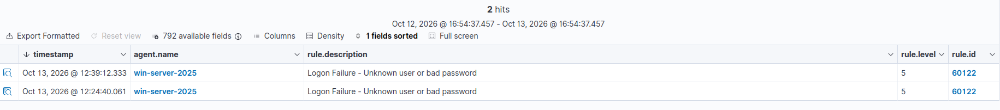

# UC03 — Intentos de autenticación fallidos contra el controlador de dominio

| Campo | Valor |
|---|---|
| Objetivo | Windows Server / Active Directory (192.168.58.137) |
| Técnica MITRE ATT&CK | [T1110.001 — Password Guessing](https://attack.mitre.org/techniques/T1110/001/) |
| Fuente de detección | Canal Windows Security (Event ID 4625), vía agente Wazuh |
| Regla Wazuh | `60122` — *Logon Failure - Unknown user or bad password* |

## Escenario

Intentos de inicio de sesión con usuario o contraseña incorrectos
contra el controlador de dominio `soclab.local`. El canal `Security`
de Windows se recoge por defecto con el agente Wazuh, sin
configuración adicional, en cuanto la auditoría de logon está
activada (ver [`02-active-directory.md`](../setup/02-active-directory.md)).

## Detección

Cada intento fallido genera el **Event ID 4625** de Windows, que
Wazuh traduce a la regla `60122` con nivel 5.

## Por qué importa en un entorno real

En un Active Directory real, este tipo de evento es una de las
señales más tempranas de un ataque de fuerza bruta, password
spraying, o de un servicio mal configurado con credenciales
incorrectas reintentando sin parar. Es también la base para detectar
ataques de **Kerberoasting** o **AS-REP Roasting** cuando se combina
con otros Event IDs (4768, 4769, 4771).

## Mejora propuesta

- Crear una regla de correlación que agrupe varios `60122` del mismo
  usuario o la misma IP de origen en poco tiempo, y los escale a un
  nivel de alerta más alto (posible fuerza bruta contra el dominio,
  no solo un fallo puntual).
- Añadir el Event ID 4740 (cuenta bloqueada) para ver el efecto de la
  política de bloqueo de cuentas tras varios fallos.
