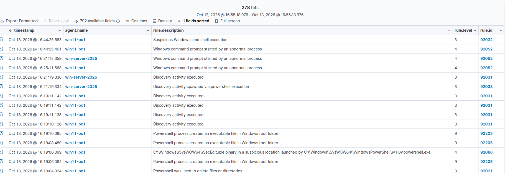
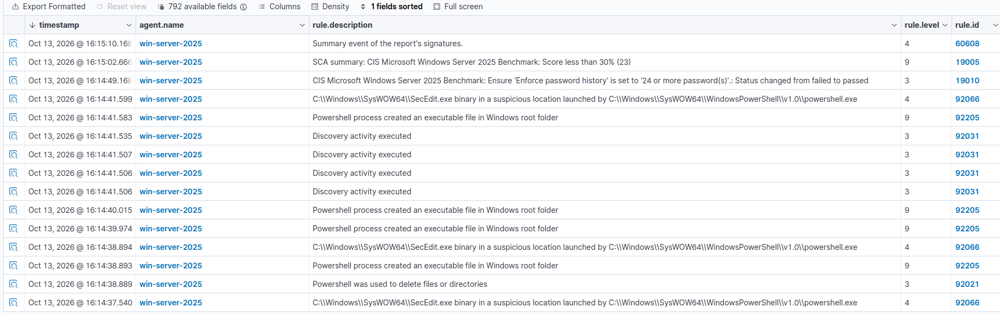

# UC04 — Actividad de descubrimiento y PowerShell sospechosa

| Campo | Valor |
|---|---|
| Objetivos | Windows Server (.137), Windows 11 (.138) |
| Técnica MITRE ATT&CK | [T1059.001 — PowerShell](https://attack.mitre.org/techniques/T1059/001/), [T1082 — System Information Discovery](https://attack.mitre.org/techniques/T1082/), [T1083 — File and Directory Discovery](https://attack.mitre.org/techniques/T1083/) |
| Fuente de detección | Sysmon (Event ID 1 - creación de proceso) vía agente Wazuh |
| Reglas Wazuh | `92031`/`92033` (discovery), `92052` (cmd anómalo), `92066` (binario en ubicación sospechosa), `92205` (ejecutable creado por PowerShell) |

## Escenario

Comandos habituales de reconocimiento de sistema ejecutados en ambos
equipos Windows para validar que Sysmon registra la actividad y que
el conjunto de reglas de Wazuh orientadas a detección de ataques
(basadas en MITRE ATT&CK) la clasifica correctamente:

```powershell
whoami /all
net user
ipconfig /all
```

Además, el módulo **SCA (Security Configuration Assessment)** de
Wazuh ejecuta internamente comandos de PowerShell y `secedit` para
evaluar el benchmark CIS del sistema, lo que también generó varias de
estas alertas.

## Detección



Vista detallada del Windows Server, con 278 coincidencias entre
ambos equipos en una ventana de 24 horas:



## Por qué se detecta

Sysmon registra el **Event ID 1** (creación de proceso) con la línea
de comandos completa y el proceso padre. Las reglas de Wazuh de la
serie `92xxx` están pensadas específicamente para detectar patrones
de ataque conocidos sobre Windows: PowerShell lanzando ejecutables
en rutas inusuales, `cmd.exe` iniciado por un proceso que normalmente
no lo hace, o utilidades de administración (`SecEdit.exe`) ejecutadas
desde una ubicación atípica.

## Nota sobre falsos positivos

Varias alertas de `SecEdit.exe` coinciden en el tiempo con el resumen
del módulo SCA de Wazuh (`Status changed from failed to passed`), lo
que indica que son generadas por el propio Wazuh al auditar la
configuración del sistema, no por un atacante. Se documenta aquí
porque **diferenciar actividad legítima de administración de una
intrusión real es parte del trabajo de un analista SOC**: se
confirma revisando `data.win.eventdata.parentCommandLine` en el
evento.

## Mejora propuesta

- Añadir una excepción (`<rule><if_sid>` con `<description>`) para
  no escalar las alertas que vienen del propio proceso de SCA de
  Wazuh, y así reducir ruido.
- Correlacionar estas alertas de discovery con los escaneos de red
  del [UC02](uc02-port-scan.md) cuando coincidan en ventana de
  tiempo, como indicio de post-explotación.
