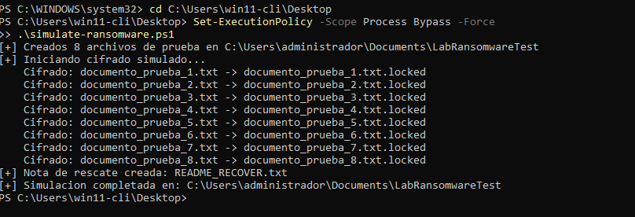
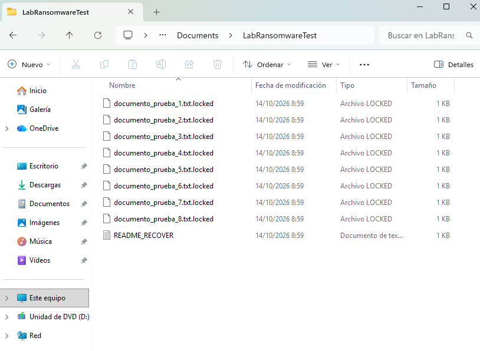
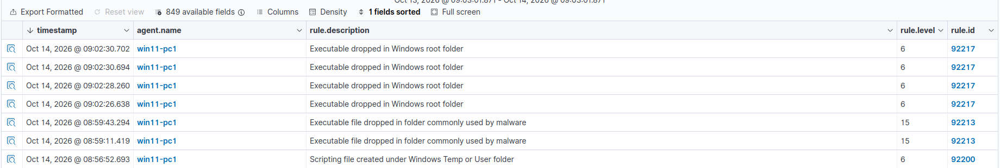
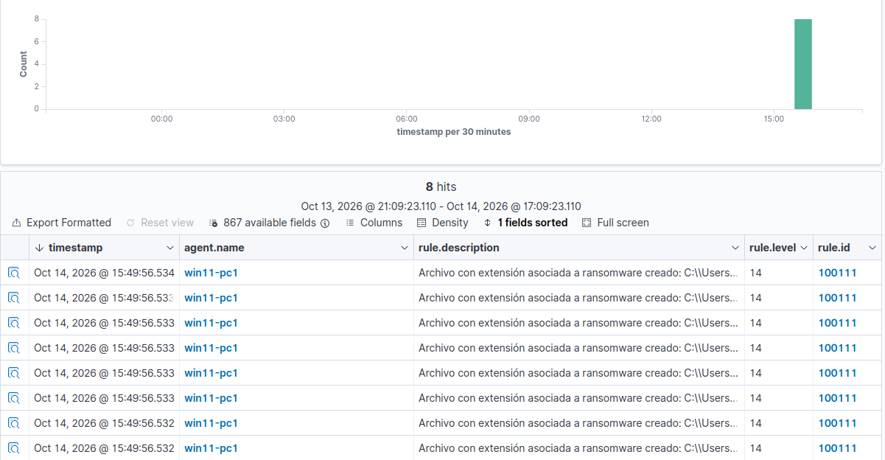
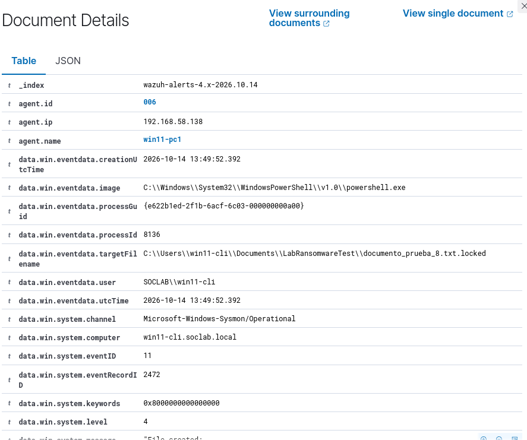

# UC05 — Simulación de ransomware en estación de trabajo

| Campo | Valor |
|---|---|
| Host afectado | Windows 11 (`win11-pc1`, 192.168.58.138) |
| Usuario | `SOCLAB\win11-cli` |
| Técnica MITRE ATT&CK | [T1486 — Data Encrypted for Impact](https://attack.mitre.org/techniques/T1486/) |
| Fuente de detección | Sysmon (Event ID 11, creación de archivo) vía agente Wazuh |
| Regla Wazuh propia | `100111` (nivel 14), hija de la regla base `61613` |
| Resultado | Detectado: 8 alertas 100111, una por archivo `.locked` |

> Ejercicio controlado en laboratorio aislado. [`simulate-ransomware.ps1`](../../scripts/simulate-ransomware.ps1)
> **no es malware**: no se propaga, no persiste, no contacta con nada
> externo y solo opera dentro de una carpeta de prueba
> (`Documents\LabRansomwareTest`). "Cifra" con un XOR reversible solo
> para generar el patrón de comportamiento de un ransomware.

## Escenario

El script reproduce el comportamiento observable de un ransomware
sobre una carpeta de usuario:

1. Crea 8 archivos señuelo (`documento_prueba_N.txt`).
2. Los "cifra" y los renombra añadiendo `.locked`.
3. Borra los originales.
4. Deja una nota `README_RECOVER.txt`.

Ejecución (PowerShell en el Windows 11):

```powershell
Set-ExecutionPolicy -Scope Process Bypass -Force
.\simulate-ransomware.ps1            # ataque
.\simulate-ransomware.ps1 -Cleanup   # limpieza
```





## Qué hizo falta para detectarlo

La detección no funcionó a la primera. Hubo que resolver tres
problemas encadenados (detalle en [`troubleshooting.md`](../troubleshooting.md), puntos 8 a 10):

| # | Problema | Solución |
|---|---|---|
| 1 | La configuración de Sysmon (SwiftOnSecurity) no registraba los `.locked` creados en `Documents` | Añadir `TargetFilename end with .locked` a `FileCreate` ([`configs/sysmon/sysmon-filecreate-ransomware.xml`](../../configs/sysmon/sysmon-filecreate-ransomware.xml)) y recargar con `Sysmon64.exe -c` |
| 2 | La regla propia colgaba de `61603` (Sysmon Event **1**, procesos) y filtraba por `targetFilename`, que solo existe en Event **11** | Cambiar `if_sid` a **`61613`** (Event 11: FileCreate) |
| 3 | La búsqueda de comprobación usaba `match_phrase: "locked"` sobre un campo `keyword`, que no coincide con la ruta completa | Buscar por `rule.id` o con `wildcard: *.locked` |

Antes de la corrección, la actividad solo generaba alertas genéricas
de la serie `92xxx`, sin ninguna específica de ransomware:



## Detección

Regla en [`detections/local_rules.xml`](../../detections/local_rules.xml):

```xml
<rule id="100111" level="14">
  <if_sid>61613</if_sid> <!-- Sysmon Event 11: FileCreate -->
  <field name="win.eventdata.targetFilename" type="pcre2">(?i)\.(locked|encrypted|crypt|enc)$</field>
  <description>Archivo con extensión asociada a ransomware creado: $(win.eventdata.targetFilename)</description>
  <mitre><id>T1486</id></mitre>
</rule>
```

Tras la corrección, las 8 creaciones de `.locked` generaron 8 alertas
de nivel 14, todas en menos de un segundo (15:49:56.532–.534) y con
unos 4 s de latencia respecto al evento (13:49:52 UTC en Sysmon):



Detalle de una de ellas: proceso `powershell.exe`, usuario
`SOCLAB\win11-cli` y ruta completa del archivo `.locked`:



Consulta para localizarlas (OpenSearch):

```
rule.id: 100111 AND agent.name: win11-pc1
```

## Por qué se interpreta como ransomware

- **Volumen y velocidad:** 8 archivos nuevos en menos de un segundo
  desde el mismo proceso; una persona no hace eso.
- **Patrón de extensión:** cambio sistemático a `.locked`.
- **Origen:** `powershell.exe` ejecutando un script desde una ruta de
  usuario.
- **Nota de rescate:** aparece `README_RECOVER.txt` en la misma carpeta.

## Triaje (Tier 1)

| Pregunta | Respuesta |
|---|---|
| ¿Falso positivo (backup, sincronización, antivirus)? | No hay proceso de backup ni AV implicado: el proceso es `powershell.exe` |
| ¿Cuántos archivos y dónde? | 8, en `Documents\LabRansomwareTest` |
| ¿Qué usuario? | `SOCLAB\win11-cli` (campo `data.win.eventdata.user`) |
| ¿Proceso conocido? | `powershell.exe` es legítimo, pero ejecuta un script no firmado; revisar la línea de comandos en Event ID 1 |

**Clasificación:** verdadero positivo (simulado).

## Contención (acciones que se tomarían en un caso real)

No se ejecutaron en el laboratorio, salvo la limpieza del script.

1. **Aislar el host de la red** para frenar la propagación:
   ```powershell
   Disable-NetAdapter -Name "Ethernet1" -Confirm:$false
   ```
2. **Preservar evidencia** antes de apagar:
   ```powershell
   wevtutil epl Microsoft-Windows-Sysmon/Operational C:\Lab\sysmon-evidencia.evtx
   ```
3. **Delimitar el alcance:** buscar en Wazuh la regla 100111 en otros agentes.
4. **Revocar credenciales** del usuario afectado si tiene acceso a recursos compartidos.
5. **Restaurar desde backup** una vez contenido; no negociar.

## Lecciones aprendidas

- **Un SIEM solo detecta lo que recibe.** Primero hay que comprobar que
  la telemetría existe (Sysmon registrando el evento) y luego que llega
  al manager (`archives.json`) antes de culpar a la regla.
- **Elegir bien la regla padre.** `61603` y `61613` son ambas Sysmon,
  pero de eventos distintos. Una regla que filtra por un campo ausente
  del evento padre no falla ni avisa: simplemente no dispara.
- **La detección por extensión es frágil.** Un ransomware que no
  cambie la extensión (o use otra) no activaría la 100111.
- **La contención fue manual.** En producción convendría automatizarla
  con Active Response.

## Mejora pendiente: regla de correlación (no validada)

Se intentó una segunda regla, `100110`, que escalara a nivel 12 al
detectar 5 o más creaciones de archivo en 10 s desde el mismo proceso
(`frequency="5" timeframe="10"` con `if_matched_sid` 61613). **No llegó
a disparar** en las pruebas, y se deja fuera de `local_rules.xml` por
no estar validada.

Hipótesis aún sin comprobar: al ser hermana de la 100111 bajo la 61613,
cada `.locked` coincide antes con la 100111, y la de frecuencia no se
evalúa. Prueba prevista: hacerla depender de la propia 100111:

```xml
<rule id="100110" level="12" frequency="5" timeframe="10">
  <if_matched_sid>100111</if_matched_sid>
  <same_field>win.eventdata.image</same_field>
  <description>Posible ransomware: 5+ archivos con extensión de ransomware en 10 s desde el mismo proceso</description>
  <mitre><id>T1486</id></mitre>
</rule>
```

Para generalizar a ransomware que no cambie la extensión habría que
contar eventos 11 genéricos por proceso, con más riesgo de falsos
positivos.
